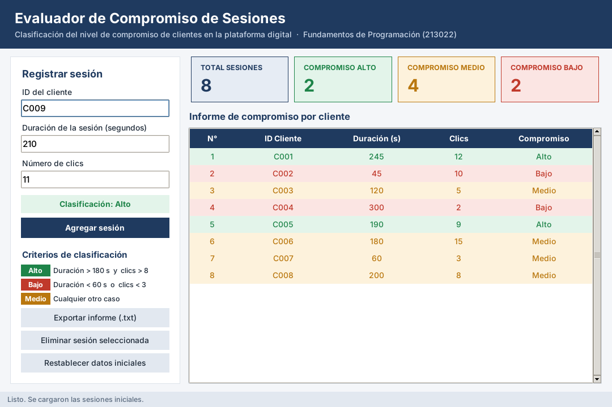

# Evaluador de Compromiso de Sesiones

**UNAD · Fundamentos de Programación (213022) · Fase 5 – Evaluación Final POA · Problema 1**

**Autora: María Claudia Ramírez Wilches**

Programa en Python que clasifica el nivel de compromiso de las sesiones de clientes de una plataforma digital. Cada sesión se guarda en una matriz con el formato `[ID del cliente, Duración (segundos), Número de clics]`.



## Reglas de clasificación

| Nivel | Condición |
| --- | --- |
| Alto | Duración > 180 s **y** clics > 8 |
| Bajo | Duración < 60 s **o** clics < 3 |
| Medio | Cualquier otro caso |

## Cómo ejecutarlo

Requiere Python 3.8 o superior. No necesita instalar paquetes: la interfaz usa `tkinter`, que viene incluido con Python.

```bash
python compromiso_sesiones.py
```

Al iniciar, el programa imprime el informe en la consola y abre la ventana con las 8 sesiones iniciales ya clasificadas.

## Funcionalidades

- Matriz inicial con 8 sesiones, incluidos casos límite (180 s, 60 s, 8 clics y 3 clics).
- Informe con el ID del cliente y su clasificación, coloreado por nivel.
- Totales por nivel de compromiso (Alto, Medio, Bajo).
- Registro de nuevas sesiones con validación (campos obligatorios, números enteros, ID no repetido) y vista previa de la clasificación.
- Eliminación de sesiones, restablecimiento de los datos iniciales y exportación del informe a `.txt`.

## Estructura del código

| Sección | Contenido |
| --- | --- |
| 1. Constantes | Umbrales de clasificación y matriz inicial |
| 2. Lógica de negocio | `clasificar_compromiso`, `generar_informe`, `contar_por_nivel`, `existe_id`, validaciones |
| 3. Interfaz gráfica | Ventana con tkinter: formulario, tarjetas de resumen y tabla del informe |
| 4. Programa principal | `main()`: informe en consola y apertura de la ventana |
